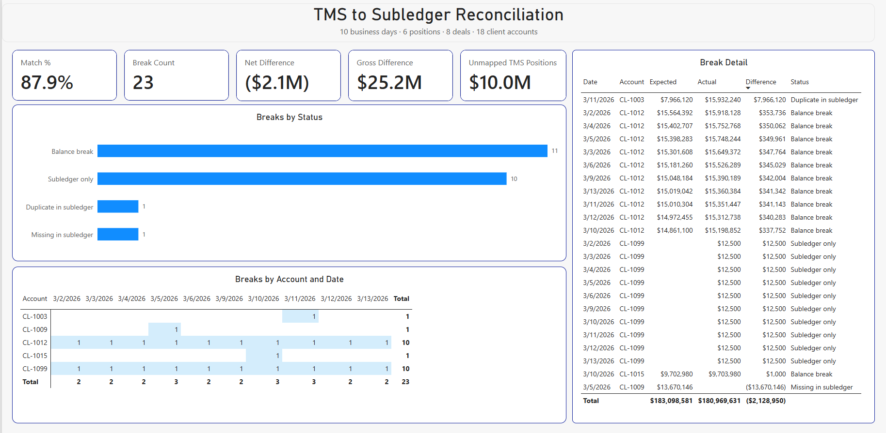
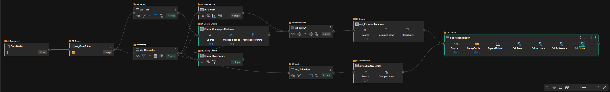

# TMS_Subledger_Recon: Multi-Level Hierarchy Reconciliation

Reconcile summary-level positions in a treasury management system (TMS) to client-level balances in a subledger, when the subledger sits **two levels below** the TMS. Built in Power Query and Power BI, with a reusable pattern for exploding amounts through a hierarchy, a full two-way reconciliation, labeled breaks, and data quality checks.



## The problem

A TMS holds money at the position level: bank accounts, money market funds, time deposits. The subledger holds the same money at the client level. In between sits a hierarchy:

```
TMS position  ──►  deal  ──►  client sub-account
 (level 0)       (level 1)       (level 2)
```

The two systems can't be compared directly. Each position has to be pushed down through both levels, split by share at each step, and every path that reaches the same client has to be added together. Some deals are funded by more than one position, and some clients sit in more than one deal, so a simple lookup gives the wrong answer.

This is the same logic as a manufacturing bill of materials explosion (how many of each part are needed to build every order), applied to a treasury reconciliation.

## Approach

1. **Staged the three sources.** TMS positions, the allocation hierarchy (Parent ID, Child ID, Share), and subledger balances are each loaded once, cleaned, and typed. A single `DataFolder` parameter controls where the files are read from.
2. **Exploded level 1.** Merged positions to the hierarchy to split each position across its deals (amount × share). A **left outer** join keeps positions with no mapping instead of silently dropping them.
3. **Exploded level 2.** Merged the result to the same hierarchy again to split each deal across its clients.
4. **Added up every path.** Grouped by date and client so a client funded through several deals or positions gets one expected balance.
5. **Reconciled both directions.** A **full outer** join against the subledger catches rows the subledger is missing and rows the TMS can't explain.
6. **Labeled every break.** Each row is classified in priority order, so structural problems are never mislabeled as simple balance differences. A $0.01 tolerance absorbs rounding from the share math.

| Status | Meaning |
| --- | --- |
| Matched | Expected and actual agree within $0.01 |
| Balance break | Both sides exist but the amounts differ |
| Missing in subledger | The TMS says the client should have a balance; the subledger has no row |
| Subledger only | The subledger has a balance the TMS and hierarchy can't explain |
| Duplicate in subledger | More than one subledger row for the same client and day |

## Data quality checks

| Check | What it verifies |
| --- | --- |
| `Check_ShareTotals` | The shares under every parent add up to 100% (rounded to 4 decimals to avoid floating-point false alarms) |
| `Check_UnmappedPositions` | Every TMS position exists in the hierarchy, using a **left anti** join |

Any row a query filters out lands in a check. Nothing is removed silently.

## Results

The synthetic data has six problems planted on purpose. All six were found.

| # | Planted problem | Caught by |
| --- | --- | --- |
| 1 | One deal's shares add up to 99% | `Check_ShareTotals` and 10 daily balance breaks |
| 2 | Duplicate subledger row | Reconciliation: Duplicate in subledger |
| 3 | Subledger account missing from the hierarchy | Reconciliation: Subledger only (every day) |
| 4 | Missing subledger row | Reconciliation: Missing in subledger |
| 5 | Balance keyed $1,000 off | Reconciliation: Balance break |
| 6 | New TMS position never mapped | `Check_UnmappedPositions` |

| Metric | Value |
| --- | --- |
| TMS positions | 6 (plus 1 unmapped) |
| Deals | 8 |
| Client sub-accounts | 18 |
| Business days | 10 |
| Rows reconciled | 190 |
| Matched | 167 (87.9%) |
| Breaks | 23 |

**Structural vs. one-off breaks:** the account-by-date heat map shows that 20 of the 23 breaks come from just two setup problems that repeat every day. Fixing the hierarchy once clears them. The remaining three are one-off data errors that need individual investigation.

**Net vs. gross difference:** the report shows both. Net difference (about −$2.1M) lets positive and negative breaks offset; gross difference (about $25.2M) shows the true size of what needs fixing.

## Query flow



```
DataFolder ─► src_DataFolder ─┬─► stg_TMS ───────┬─► int_Level1 ─► int_Level2 ─► out_ExpectedBalances ─┐
                              ├─► stg_Hierarchy ─┤                                                     ├─► out_Reconciliation
                              │                  ├─► Check_ShareTotals                                 │
                              │                  └─► Check_UnmappedPositions                           │
                              └─► stg_Subledger ─► int_SubledgerTotals ────────────────────────────────┘
```

## Project structure

```
TMS_Subledger_Recon/
├── README.md
├── make_data.py                     # generates the synthetic data, with planted problems
├── data/
│   ├── tms_positions.xlsx           # level 0: TMS positions by day
│   ├── allocation_hierarchy.xlsx    # Parent ID, Child ID, Share
│   └── subledger_balances.xlsx      # level 2: client balances by day
├── PowerQuery/                      # every query as a readable .pq file
├── PowerBi/
│   ├── TMS_Subledger_Recon.pbip     # Power BI Project (queries, model and report as text)
│   ├── TMS_Subledger_Recon.Report/
│   └── TMS_Subledger_Recon.SemanticModel/
└── images/
    ├── TMS_report.png
    └── TMS_diagram_view.png
```

## How to run it

1. Download or clone this repository.
2. Open `PowerBi/TMS_Subledger_Recon.pbip` in Power BI Desktop.
3. In Power Query Editor, set the `DataFolder` parameter to your copy of the `data` folder (end the path with a backslash).
4. Click **Refresh**.

To regenerate the test data: `pip install pandas openpyxl`, then `python make_data.py`.

## Notes

- **All data is synthetic.** Positions, banks, deals, and clients are fictional. No real or employer data is used.
- The test data was generated with a Python script built with AI assistance (Claude), designed to reproduce real reconciliation problems: a mapping error, an unmapped position, an orphan account, a missing row, a duplicate, and a keying error.
- The hierarchy has exactly two levels, so the explosion uses two merges. A recursive version that handles any number of levels is a planned enhancement.

## About

Built by Matthew D. Parker, a treasury analytics professional who builds end-to-end reporting platforms in Power BI, Power Query, and Python.
[LinkedIn](https://www.linkedin.com/in/matthewdavidparkermba) · [More projects](https://github.com/matthewdavidparker)
